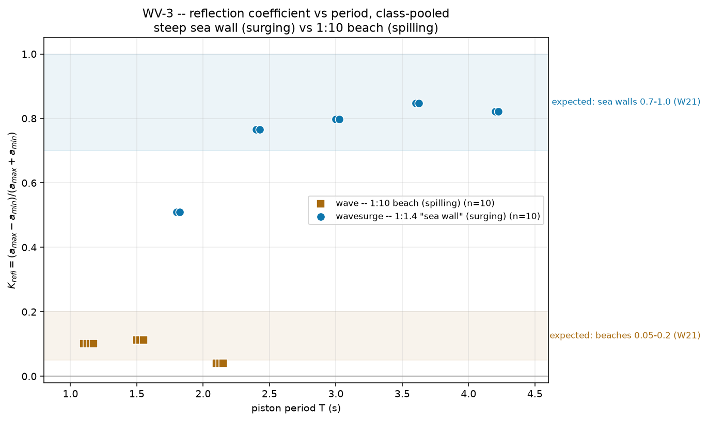

# WV-3 · Reflection coefficient of a steep sea wall

Every student slides one wave gauge along a flume that ends in a steep, smooth
1:1.4 slope, reading the biggest (antinode) and smallest (node) swing the
reflected wave leaves behind in its partial standing pattern. `K_refl` from
those two numbers lands high — measured 0.51–0.85 across the class's periods,
most of them 0.77–0.85 —
and that IS the textbook sea-wall figure, measured rather than assumed. A short
second run on the gentle 1:10 beach, same water and same paddle, gives a low
one by exactly the same method: the class has measured, not been told, why
revetments are built gentle when reflection is the enemy.

**Open it:** press **E** in the [app](../../../../)
and pick **WV-3**, or use the direct link
[`?ex=WV-3`](../../../../?ex=WV-3).
How to run any exercise: see the [teaching pack index](../../INDEX.md#running-an-exercise).

## Theory

An incident wave and its reflection add to a standing pattern whose envelope
is fat at the antinodes and thin at the nodes:

    K_refl = H_r / H_i = (a_max − a_min) / (a_max + a_min)
    node-to-node spacing = L/2,   with  σ² = g·k·tanh(k·h)

A perfect reflector leaves `a_min = 0` and `K_refl = 1`; a perfect absorber
leaves no pattern at all and `K_refl = 0`. Textbook values: sea walls 0.7–1.0,
beaches 0.05–0.2. Measured still-water depth **h = 0.348 m**, with **7.7 m** of
flat bed between the paddle and the beach toe at x = 8.0 m.

## Your period and stroke

**d** is the **last digit of your student number** — your lecturer will
explain the assignment in class. Take your period from the table (digits pair
up: 0,1 → 1.80 s and so on), and with it the paired stroke.

| d | 0 | 1 | 2 | 3 | 4 | 5 | 6 | 7 | 8 | 9 |
|---|---|---|---|---|---|---|---|---|---|---|
| **T (s)** | 1.80 | 1.80 | 2.40 | 2.40 | 3.00 | 3.00 | 3.60 | 3.60 | 4.20 | 4.20 |
| **stroke (m)** | 0.080 | 0.080 | 0.110 | 0.110 | 0.140 | 0.140 | 0.170 | 0.170 | 0.200 | 0.200 |

The contrast run on the gentle beach (`wave`) goes by **d mod 3** instead:

| d mod 3 | 0 (d = 0,3,6,9) | 1 (d = 1,4,7) | 2 (d = 2,5,8) |
|---|---|---|---|
| **T (s)** | 1.10 | 1.50 | 2.10 |
| **stroke (m)** | 0.055 | 0.060 | 0.070 |

## What to do

1. Under **Controls → Wavemaker**, set **Period** and **Amplitude** to your
   row.
2. Press `R` and let it reach steady state — about **45 s**; the card counts
   it down. Most of that is travel: the wave has to reach the beach 7.7 m away
   and its reflection has to cross back before a pattern exists to measure.
3. Press `0` to see the whole flat run, then with **Gauge** (`5`) click
   mid-depth at **x = 1.3 m** and read the swing in **d** off the card —
   promptly, because the chart only remembers about 15 s.
4. Click again every **0.2 m** out to **x = 7.5 m**, noting the biggest swing
   (an antinode) and the smallest (a node). With a = ½(highest − lowest) at
   each, submit **T** and **K_refl = (a_max − a_min)/(a_max + a_min)**.

**Also:** repeat on **wave** (Scenes menu) with your `d mod 3` row, submitted
as `series = spilling`. Its flat run is only x = 0.65–1.15 m, so step the gauge
by 0.1 m across that — and the swing barely changing from one end to the other
IS the result.

> Re-measured Oct 2026 with the mixing-length closure off in the wave flumes
> (mvreeuwijk/hydraulician#2); the closure-off values are at the flumes' new
> default ν = 1e-4 m²/s (at 1e-5 the short waves fill with grid noise).
> `K_refl` on `wavesurge` (DFT envelope scan, 33 stations, 10 periods) went
> 0.66 / 0.76 / 0.83–0.90 / 0.85 / 0.85 to 0.51 / 0.77 / 0.80 / 0.85 / 0.82 at
> T = 1.8 / 2.4 / 3.0 / 3.6 / 4.2 s, so the old monotone rise is gone: 1.8 s
> is the lowest (a_min 0.013 m of a_max 0.041 m) and the rest sit together at
> 0.77–0.85. Closure-on reruns (ν = 1e-5) gave 0.87 at 3.0 s and 0.60 at
> 1.8 s, within the old scatter; an earlier closure-off pass at ν = 1e-5 gave
> 0.47 / 0.66 / 0.97 / 0.93 / 0.81, with deeper nodes than ν = 1e-4 leaves
> (a_min 0.001–0.002 m at 3.0 and 3.6 s, now 0.008 and 0.004 m). On `wave`
> (two-probe) the closure-on rerun gave 0.18 / 0.02 / 0.15 and the closure-off
> run at ν = 1e-4 gives 0.10 / 0.11 / 0.04 at T = 1.1 / 1.5 / 2.1 s; the old
> 0.34 / 0.07 / 0.04 was not reproduced at 1.1 s — two-probe K on this 0.9 m
> flat run moves by ±0.1 with probe-amplitude mismatches of a few percent, so
> read it as "inside, or just under, the 0.05–0.2 beach band". At 3.0, 2.4 and
> 4.2 s the 0.75-depth probe goes dry at the deepest troughs (wet margin 0),
> which clips the troughs at the antinodes slightly.

## For the instructor — pooling the class

Collect one row per student (`student,digit,series,T_s,Krefl`, with `series`
either `surging` or `spilling`), export the CSV and run:

```bash
python3 collect_plot.py class.csv                # -> plots/pooled-demo.png
python3 collect_plot.py data/simulated-class.csv # the shipped dry-run class
```

The script plots `K_refl` against period, one colour per series, over the two
textbook bands, and prints how many points of each series landed inside its
own band.



### Discussion points

- **Expect the submitted numbers to run low on `wavesurge`** — (closure-on
  value, not re-measured: nearer 0.4–0.6 than the 0.85 this folder's own scans
  measured.) A ~15 s peak-to-peak read
  cannot resolve the tiny true signal at a node against the ripple sitting on
  top of it, so `a_min` comes out roughly twice too big and drags `K_refl`
  down; with the closure off at ν = 1e-4 the true node is `a_min` ≈ 0.004–0.009 m
  at 3.0–4.2 s, so the eyeball shortfall is smaller but still there. The
  contrast survives: the scans give 0.51–0.85 on `wavesurge` against 0.04–0.11
  on `wave`, and a ~0.4 eyeball reading still clears every spilling point.
- **The standing pattern is a free check on WV-1.** Leave gauges at two
  neighbouring nodes and measure the gap with **Measure** (`8`): it should be
  `L/2` from `σ² = gk tanh kh`, and here it is — to within the 0.2 m station step
  at 3.0 and 3.6 s (2.8 and 3.4 m against 2.70 and 3.27 m). At 4.2 s the envelope
  names only two nodes, 4.2 m apart against 3.83 m; at 2.4 s three nodes give 2.0,
  1.0 and 1.2 m against 2.13 m, and at 1.8 s five nodes 0.4–1.6 m apart against
  1.54 m, so the envelope is too ragged to trust there (and at 3.6 s one extra
  node near x = 1.8 m is spurious). The old "1.7% across four periods" was a
  closure-on figure and is not reproduced. A
  standing wave carries the dispersion relation in its own geometry.

The full verification record — the probe-height and measuring-zone
calibrations, the envelope scan at every period tried, the node-spacing and
two-probe cross-checks, the eyeball-versus-DFT margin behind the caution
above, safe bounds and troubleshooting — is kept locally, out of version control, at
`courses/original/exercises/WV-3-reflection/_archive/README-full.md`.
