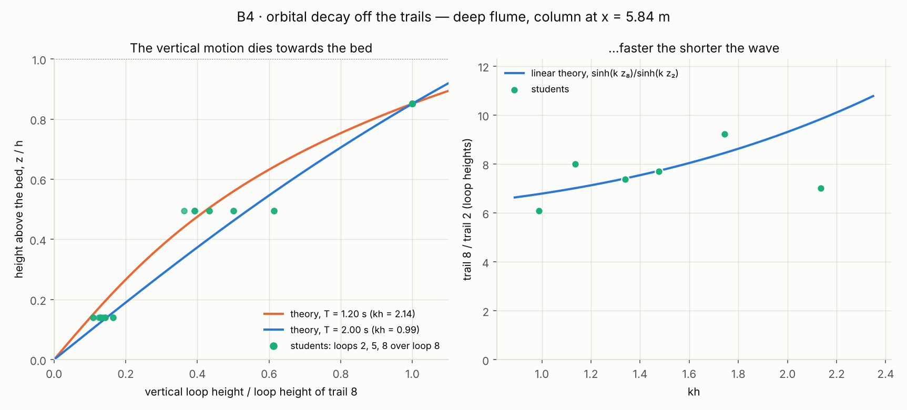

# B4 · Orbital decay, measured off the trails

## Lecturer notes

A quick in-class exercise, 15 minutes, on how a wave's orbital motion dies
with depth. Each student runs the deep flume at their own period, pauses on
the column of nine orbit tracers at x = 5.84 m, and measures the height of
one loop on three of the trails — near the surface, at mid-depth and near the
bed. Linear theory says the vertical excursion falls as `sinh(kz)`, z above
the bed: about eight times smaller from trail 8 to trail 2, and a flat line
at the bed itself. The horizontal motion does not vanish there, and the
bottom trail shows it: a long, nearly flat streak.

Students submit **T and the three loop heights**; the class pools them as a
profile, each loop over the student's own trail 8, against height above the
bed, on the theory curves for the shortest and longest period in the room.

**Open it:** press **E** in the [app](https://barneydobson.github.io/hydraulician/)
and pick **B4**, or use the direct link
[`?ex=B4`](https://barneydobson.github.io/hydraulician/?ex=B4).
How to run any exercise: see the [teaching pack index](../INDEX.md#running-an-exercise).
It runs on the `wavedeep` scene; the card sets everything up.

## The flume

`wavedeep` is a 12 m flume, 1.5 m tall, per metre width: a flat bed at
z = 0.26 m, still water to z = 1.00 m (h = 0.743 m as the solver holds it),
a piston paddle at x = 0.30 m and a 1 : 3.4 beach from x = 8.2 m. Medium
gives Δx = 13.8 mm, 54 cells over the depth. The card sets Medium, the
paddle on, the tracer column at x = 5.84 m with nine tracers and 3 s trails,
×6 vertical exaggeration, and particles off.

The tracers are seeded from 1.65 cm above the bed to 2.2 cm below the still
surface, 8.80 cm apart: trails 2, 5 and 8 stand at **z = 0.105, 0.369 and
0.633 m** above the bed. A tracer is put back on the column when it has
drifted 0.9 m from it (main.js `advanceTracers`), which on these runs happens
every few seconds near the surface and the bed.

The wait is about **40 s**: the train has to reach mid-tank and the mean
current under it has to establish.

## The assignment

**d** is the last digit of the student number. The card prints the rule:

| d | 0 | 1 | 2 | 3 | 4 | 5 | 6 | 7 | 8 | 9 |
|---|---|---|---|---|---|---|---|---|---|---|
| **T (s)** | 1.20 | 1.20 | 1.35 | 1.35 | 1.50 | 1.50 | 1.60 | 1.80 | 2.00 | 2.00 |
| **stroke (m)** | 0.19 | 0.19 | 0.23 | 0.23 | 0.28 | 0.28 | 0.30 | 0.30 | 0.30 | 0.30 |

Periods start at 1.2 s because a shorter wave does not reach the column.
The old ladder ran from 0.60 s; measured at the stroke it paired with
0.75 s, the wave is 0.20 m high at x = 0.6 m — steeper than a wave can
stand — and 2 mm at x = 2 m. A student on a short period paused on still
water. The stroke tops out at the slider's 0.30 m from 1.6 s.

## What the students do

1. Set Period and Amplitude from the digit and press **R**; wait out the
   settle.
2. Zoom onto the column. Each trail is the last 3 s of one tracer: a loop
   per wave, sliding sideways.
3. Pause. With **Measure** (`8`), drag straight down across one loop of
   trail 8, then trail 5, then trail 2, and read each length. Measure
   prints true metres whatever the exaggeration: to the millimetre below
   0.1 m, to the centimetre above.
4. Look at trail 1 and describe it.
5. Submit T and the three loop heights in mm.

## Theory

Under a linear wave of amplitude a, a particle at height z above the bed
moves round an ellipse with

    horizontal semi-axis  a · cosh(kz)/sinh(kh)
    vertical semi-axis    a · sinh(kz)/sinh(kh)        σ² = gk·tanh(kh),  σ = 2π/T

so the height of a loop is 2a·sinh(kz)/sinh(kh), and the ratio of two trails
is `sinh(k z₁)/sinh(k z₂)`, independent of a. The vertical motion goes to
zero at the bed, where the water cannot move through it; the horizontal does
not, and near the bed it is a/sinh(kh), a back-and-forth slide. For deep water
(kh large) both fall as e^{−k(h−z)}; for shallow water the vertical one falls
linearly to the bed.

Worked example, T = 1.50 s: kh = 1.48, k = 1.99 m⁻¹, so trail 8 over
trail 2 is sinh(1.26)/sinh(0.209) = 7.7, trail 5 over trail 8 is
sinh(0.733)/sinh(1.26) = 0.49, and trail 8 over trail 1 is 49.

## Measured answers

Medium, after the 40 s settle, each tracer's position sampled every T/24 for
12 s by `rig.js`, which moves the tracers exactly as the frame loop does.
The loop height is the median, over the whole periods in the record, of a
trail's vertical extent within one period; periods that straddle a reset are
skipped (3–5 loops a trail). H is the wave's height at the column from the
fitted surface.

| T (s) | kh | H at x = 5.84 m | trail 2 | trail 5 | trail 8 | 8 / 2 (theory) | 5 / 8 (theory) | trail 1 |
|---|---|---|---|---|---|---|---|---|
| 1.20 | 2.14 | 0.10 m | 7.9 | 22 | 56 | 7.1 (9.8) | 0.39 (0.42) | 1.2 |
| 1.35 | 1.74 | 0.16 m | 13.5 | 52 | 118 | 8.8 (8.5) | 0.44 (0.47) | 2.0 |
| 1.50 | 1.48 | 0.19 m | 12.5 | 50 | 105 | 8.3 (7.7) | 0.48 (0.50) | 2.6 |
| 1.60 | 1.34 | 0.20 m | 18.5 | 55 | 144 | 7.8 (7.4) | 0.38 (0.51) | 2.7 |
| 1.80 | 1.14 | 0.20 m | 19.6 | 58 | 158 | 8.1 (7.0) | 0.36 (0.53) | 2.9 |
| 2.00 | 0.99 | 0.23 m | 22.6 | 86 | 145 | 6.4 (6.8) | 0.59 (0.54) | 3.2 |

Loop heights in mm. Trail 8 over trail 2 lands within −5% to +15% of
theory from 1.35 s up. At 1.2 s it reads 28% low: trail 2's loop should be
7 mm there, and the drift puts a few millimetres of vertical wobble into
every near-bed trail — trail 1, whose loop should be about 1 mm, reads
1–3 mm. Trail 5 over trail 8 lands within −31% to +10%, because the mean
current changes direction near mid-depth and stretches those loops. Trail 1
is the flat line the theory predicts, with the horizontal motion still
there: hundreds of millimetres long.

The dry-run class, single reads rounded as Measure prints them, pools to
trail 8 over trail 2 at −5% of theory with a spread of 14%, and trail 5
over trail 8 at −5% with a spread of 13%.

**The current under the waves.** At these strokes the flume carries a mean
circulation as strong as the orbits: at the column, +0.12 to +0.18 m/s 8 cm
below the still surface and −0.12 to −0.32 m/s 9 cm above the bed. The waves
lose height steadily along the flume (0.10–0.23 m at the column against
0.31–0.48 m at x = 1 m), and that lost momentum drives the surface water
forward; the return flow runs along the bed. A real flume does this too, more gently. It
is why the trails drift, why they are reset every few seconds, and why the
reading is one loop rather than a whole trail. See the engineering notes,
"The deep flume's mean circulation".

**Why only 1.2–2.0 s.** Over that range kh runs from 2.1 to 1.0 and trail 8
over trail 2 only from 9.8 to 6.8 in theory, a third. With single-loop reads
the class will show the decay profile clearly and the kh trend only roughly.
The shorter periods, where the profile would collapse towards the surface,
cannot be measured here: the model damps a short wave by resolution (the
engineering notes, "Surface waves are damped by RESOLUTION"), and the
strokes that once got one to mid-tank make it break at the paddle instead.
Measured, T = 0.75 s at 0.08 m and T = 0.90 s at 0.11 m are 0.20 and
0.26 m high at x = 0.6 m and gone by x = 2 and 3 m.

## Pooling the class

Collect one row per student, `student,digit,T_s,loop2_mm,loop5_mm,loop8_mm`
(an optional `loop1_mm`; extra columns ignored), export the CSV and run:

```bash
python3 collect_plot.py class.csv                 # -> plots/pooled-demo.png
python3 collect_plot.py data/simulated-class.csv  # the shipped dry-run class
```

The left panel plots every student's loops 2, 5 and 8, each over their own
loop 8, against z/h, over `sinh(kz)/sinh(k z₈)` at the class's shortest and
longest period. The right plots loop 8 over loop 2 against kh, on the theory
curve. The dry-run class is the measured table above, one row per digit,
rounded the way Measure prints.



## Discussion points

- **Where does the vertical motion go?** The bed is a wall: nothing moves
  through it, so the vertical excursion has to be zero there. The horizontal
  one does not have to be, and trail 1 shows it.
- **Why sinh and not e^{−kz}?** Ask what the profile would look like in very
  deep water, and in water much shallower than the wavelength. This flume
  sits between the two.
- **Why do the trails drift?** The class sees the near-surface trails slide
  one way and the near-bed trails the other. That is a mean circulation, not
  the waves: the surface water is pushed along by the momentum the decaying
  waves give up, and it returns along the bed.
- **What is a seabed pressure gauge looking at?** The same decay sets how
  much of a passing wave reaches the bed. WV-2 measures it with pressure
  gauges instead of tracers.

## Console spot-check

Paste [rig.js](rig.js) into the console and run `await B4.run(1.50, 0.28)`
for one row: it picks B4, sets the period and stroke, presses R, settles,
follows the nine tracers for 12 s and returns each trail's loop height with
the theory and the ratios. `await B4.sweep()` runs every row the card
prints.
