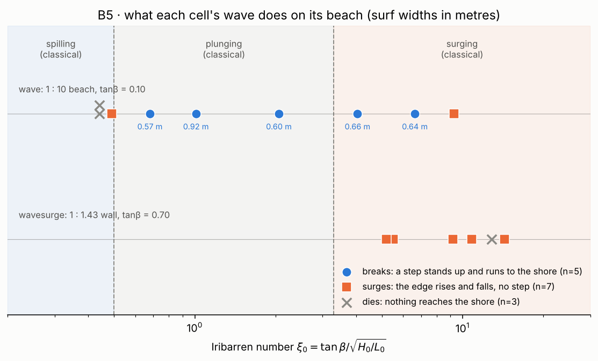

# B5 · Iribarren map jigsaw

## Lecturer notes

A quick in-class exercise, 20 minutes, for pairs. Each pair is handed one
point on the Iribarren map — a beach, a period and a stroke, fifteen cells
across two beaches — and reports what the wave does when it gets there:
breaks, surges, or dies on the way. Pooled on a log-ξ₀ axis, each beach's
cells fall in order of ξ₀: on the gentle beach the waves break from
ξ₀ = 0.7 to 6.6 and surge beyond, and every wave that reaches the steep wall
surges. The class reads off where this model's change-over lies against the
textbook's 3.3, and finds it is not the same on both beaches.

Pairs submit **cell, ξ₀ (from the table), behaviour and, if it breaks, the
surf width**; the class pools behaviour against ξ₀.

**Open it:** press **E** in the [app](https://barneydobson.github.io/hydraulician/)
and pick **B5**, or use the direct link
[`?ex=B5`](https://barneydobson.github.io/hydraulician/?ex=B5).
How to run any exercise: see the [teaching pack index](../INDEX.md#running-an-exercise).
It runs on the `wave` scene, and cells 10–15 on `wavesurge` from the Scenes
menu; the card's settings come along to the second flume.

## The flumes

Both are 12 m flumes per metre width with still water h = 0.348 m deep over
a flat bed at z = 0.247 m and a piston paddle at x = 0.30 m. Medium gives
Δx = 11.2 mm, 31 cells over the depth.

- `wave`: a 1 : 10 beach (tanβ = 0.10) from x = 1.2 m; the still shoreline
  is at **x = 4.7 m**.
- `wavesurge`: a 1 : 1.43 wall (tanβ = 0.70) from x = 8.0 m; the still
  shoreline is at **x = 8.5 m**.

The wait is about **40 s**.

**What "breaks" can mean at Medium.** The strokes are small, so the waves
arriving at the beach are 1–7 cm high, one to six cells. That is enough to
see a wave steepen until its front stands up as a step and runs up the
beach as a bore, and the class can see where that happens; it is not enough
to tell a spilling crest from a plunging one, and nothing in this model
plunges — an overturning tongue is thinner than the interface can hold (the
engineering notes, "Plunging breakers are out of reach"). So the card asks
for three behaviours, each one a thing that can be seen:

- **breaks** — a step stands up in the surface on the slope and runs to the
  shore. Measured, the surface averaged over five columns falls shoreward
  steeper than the beach by at least 0.4 somewhere in water deeper than
  3 cm: 1 in 2 on the 1 : 10 beach, 1.1 in 1 on the wall, where water
  sliding up and down a 1 : 1.43 slope is that steep without breaking. On
  the 1 : 10 beach the cells that break reach 0.79–1.02 by that measure and
  the ones that do not 0.43 at most; on the wall none comes near.
- **surges** — the water's edge rises and falls, and no step forms.
- **dies** — the wave is under 1.5 cm high by the time the still water is
  10 cm deep: on screen, nothing reaches the shore.

## The assignment

Cells, not digits; give each pair a cell number. ξ₀ is measured (see below),
so pairs submit it rather than derive it.

**`wave` — the 1 : 10 beach**

| cell | 1 | 2 | 3 | 4 | 5 | 6 | 7 | 8 | 9 |
|---|---|---|---|---|---|---|---|---|---|
| **T (s)** | 0.70 | 0.90 | 1.10 | 1.50 | 2.10 | 3.00 | 4.00 | 5.00 | 6.00 |
| **stroke (m)** | 0.035 | 0.045 | 0.055 | 0.060 | 0.070 | 0.055 | 0.045 | 0.035 | 0.030 |
| **ξ₀** | 0.44 | 0.44 | 0.49 | 0.68 | 1.01 | 2.06 | 4.05 | 6.63 | 9.29 |

**`wavesurge` — the 1 : 1.43 wall**

| cell | 10 | 11 | 12 | 13 | 14 | 15 |
|---|---|---|---|---|---|---|
| **T (s)** | 0.80 | 1.40 | 1.40 | 1.80 | 3.00 | 4.20 |
| **stroke (m)** | 0.060 | 0.130 | 0.173 | 0.080 | 0.140 | 0.200 |
| **ξ₀** | 13 | 5.50 | 5.19 | 9.19 | 10.80 | 14.36 |

Cell 10's wave arrives at the wall 3 mm high, so its ξ₀ is computed but
means little; see below.

## What the pairs do

1. Cells 10–15: open `wavesurge` from the Scenes menu first.
2. Set Period and Amplitude from the cell and press **R**; wait out the
   settle.
3. Zoom on the beach and watch at least five waves arrive; decide breaks,
   surges or dies by the definitions above.
4. If it breaks, pause as the step first stands up and left-drag **Measure**
   (`8`) from it to the still shoreline: the surf width. Three waves, keep
   the middle reading.

## Theory

The breaker type is set by one number, the beach slope against the
deep-water steepness of the wave:

    ξ₀ = tanβ / √(H₀/L₀),   L₀ = gT²/2π
    spilling ξ₀ < 0.5 · plunging 0.5–3.3 · surging (and collapsing) ξ₀ > 3.3

H₀ is the deep-water height that would shoal to the height measured at the
toe: H = Ks·H₀ with Ks = √(cg₀/cg), linear theory, cg₀ = gT/4π.

Worked example, cell 5: T = 2.10 s, so L₀ = 6.89 m; the wave arrives at the
toe 0.069 m high in 0.348 m of water, kh = 0.60 and Ks = 1.02, so
H₀ = 0.068 m and ξ₀ = 0.10/√(0.068/6.89) = 1.01.

## Measured answers

Medium, after the 40 s settle (45 s for cells 13–15, shared with WV-3):
headless runs recording the surface along the whole flume 16–24 times a
period for 15–25 s, read with [rig.js](rig.js)'s criteria. H at the toe is
the incident height: an incident and a reflected wave, each decaying, fitted to the first
harmonic of the surface along the flat and evaluated at the toe. The step
is where the five-column surface first falls shoreward 0.4 steeper than the
beach in water at least 3 cm deep; the surf width runs from there to the
still shoreline.

| cell | beach | T (s) | stroke (m) | H at the toe (m) | H₀ (m) | ξ₀ | behaviour | step forms at x (m) | surf width (m) | H where d = 10 cm (m) |
|---|---|---|---|---|---|---|---|---|---|---|
| 1 | wave | 0.70 | 0.035 | 0.039 | 0.039 | 0.44 | dies | — | — | 0.011 |
| 2 | wave | 0.90 | 0.045 | 0.061 | 0.065 | 0.44 | dies | — | — | 0.011 |
| 3 | wave | 1.10 | 0.055 | 0.073 | 0.079 | 0.49 | surges | — | — | 0.032 |
| 4 | wave | 1.50 | 0.060 | 0.071 | 0.076 | 0.68 | breaks | 4.12 | 0.57 | 0.061 |
| 5 | wave | 2.10 | 0.070 | 0.069 | 0.068 | 1.01 | breaks | 3.76 | 0.92 | 0.068 |
| 6 | wave | 3.00 | 0.055 | 0.039 | 0.033 | 2.06 | breaks | 4.08 | 0.60 | 0.047 |
| 7 | wave | 4.00 | 0.045 | 0.020 | 0.015 | 4.05 | breaks | 4.03 | 0.66 | 0.044 |
| 8 | wave | 5.00 | 0.035 | 0.013 | 0.009 | 6.63 | breaks | 4.04 | 0.64 | 0.024 |
| 9 | wave | 6.00 | 0.030 | 0.010 | 0.007 | 9.29 | surges | — | — | 0.022 |
| 10 | wavesurge | 0.80 | 0.060 | 0.003 | 0.003 | 12.84 | dies | — | — | 0.010 |
| 11 | wavesurge | 1.40 | 0.130 | 0.046 | 0.050 | 5.50 | surges | — | — | 0.094 |
| 12 | wavesurge | 1.40 | 0.173 | 0.051 | 0.056 | 5.19 | surges | — | — | 0.130 |
| 13 | wavesurge | 1.80 | 0.080 | 0.029 | 0.029 | 9.19 | surges | — | — | 0.056 |
| 14 | wavesurge | 3.00 | 0.140 | 0.069 | 0.059 | 10.80 | surges | — | — | 0.165 |
| 15 | wavesurge | 4.20 | 0.200 | 0.089 | 0.065 | 14.36 | surges | — | — | 0.222 |

What the table says:

- **ξ₀ orders the behaviour on each beach.** On the 1 : 10 beach the waves
  that break span ξ₀ = 0.68–6.6, the one beyond surges (9.3), and below
  0.5 the waves die or arrive too small to step. On the wall every wave
  that arrives surges, ξ₀ = 5.2–14.4.
- **The model's surging line sits higher than the textbook's on the gentle
  beach.** Cells 7 and 8 (ξ₀ 4.1 and 6.6) form a step 0.6 m from the
  shore where the textbook says they should surge: a long wave has 3.5 m of
  shoaling, shallow water to steepen in, and five or six cells of depth at
  the end to stand up in. On the wall, half a metre long, cell 11 surges at
  ξ₀ = 5.5.
- **The short waves die, and that is the model.** These waves lose about
  60% of their height per wavelength to the discretisation (the `wave`
  scene's notes), so a 0.7 or 0.9 s wave still 4–6 cm high at the toe is
  under 1.5 cm by the time the water is 10 cm deep. On the wall's 7.7 m flat
  the 0.8 s wave arrives 3 mm high, which puts its ξ₀ at 13: a number with
  nothing behind it.
- **Nothing plunges.** An overturning tongue is thinner than the interface
  can hold, so the classical plunging band is either a step that runs up
  the beach or a surge.
- **The old ξ₀ were too low on the wall.** Measured near the paddle, they
  ignored the height the wave loses on the 7.7 m flat; at the toe the same
  cells read 3.8 and 3.4 at 1.4 s against 5.5 and 5.2 now, 5.5 at 1.8 s
  against 9.2, 8.2 at 3.0 s against 10.8. On the 1 : 10 beach, where the
  flat is 0.9 m, the change is small except at 0.9 and 1.1 s (0.92 and 0.73
  then, 0.44 and 0.49 now).

## Pooling the class

Collect one row per pair, `pair,cell,scene,xi0,behaviour,surf_width_m`
(extra columns ignored), export the CSV and run:

```bash
python3 collect_plot.py class.csv                 # -> plots/pooled-demo.png
python3 collect_plot.py data/simulated-class.csv  # the shipped dry-run class
```

The script draws one lane per beach on a log-ξ₀ axis over the classical
bands, colours each cell by its behaviour, writes each breaking cell's surf
width under it, and prints the ξ₀ range of each behaviour on each beach.
The dry-run class is the measured table.



## Discussion points

- **Where is this model's surging line?** Read it off the class plot, beach
  by beach, and set it against 3.3. Is ξ₀ the whole story when the same
  number breaks on one beach and surges on the other?
- **Why do the shortest waves die?** Put two Depth gauges on the flat, one
  at the paddle and one at the toe, and compare. Damping that strong is a
  property of the grid, not of water; a finer resolution would move the
  low end of the map.
- **What would plunge?** Ask what the interface would have to resolve for
  a tongue to curl over, against 11 mm cells.
- **Surf width against ξ₀.** The breaking cells' surf widths are 0.57–0.92
  m: is there a trend, and what sets it on a 3.5 m beach?

## Console spot-check

Paste [rig.js](rig.js) into the console and run `await B5.run(5)` for one
cell: it picks B5, takes the cell's flume, sets the period and stroke,
presses R, settles, watches 12 s of the surface along the flume and returns
the incident height at the toe, H₀, ξ₀, the behaviour by the three
definitions above, where the step forms and the surf width.
`await B5.sweep()` runs all fifteen.
