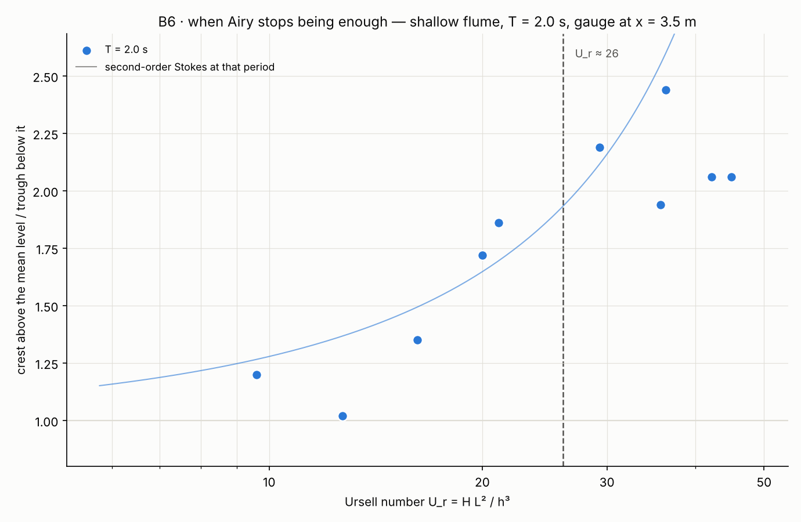

# B6 · Ursell number: when Airy stops being enough

## Lecturer notes

A quick in-class exercise, 25 minutes, on the edge of linear wave theory.
The whole class runs the shallow flume at one period, 2.0 s, each student
at their own stroke. Each measures their wave's height H and length L
between two depth gauges and works out the Ursell number
`U_r = H L²/h³`, and reads how lopsided the wave is: how far the crest
stands above the mean level against how far the trough falls below it.
Airy theory makes those two equal; the classical rule is that it is a fair
description while U_r stays below about 26. The class's ten strokes run
U_r from 10 to 45, through 26, so the pooled plot shows the crest standing
up as U_r approaches the line, and the measured shape leaving second-order
theory past it.

Students submit **stroke, H, L, U_r and the asymmetry**; the class pools
asymmetry against U_r.

**Open it:** press **E** in the [app](https://barneydobson.github.io/hydraulician/)
and pick **B6**, or use the direct link
[`?ex=B6`](https://barneydobson.github.io/hydraulician/?ex=B6).
How to run any exercise: see the [teaching pack index](../INDEX.md#running-an-exercise).
It runs on the `waveshallow` scene; the card sets everything up, the period
included.

## The flume

`waveshallow` is a 12 m flume per metre width: a flat bed at z = 0.247 m,
still water h = 0.348 m deep, a piston paddle at x = 0.30 m and a 1 : 20
beach from x = 4.0 m, so 3.7 m of flat bed. Medium gives Δx = 11.2 mm,
31 cells over the depth. The card sets Medium, the period, the paddle on,
the gauges on Depth and particles off. The gauges go at **x = 1.5 and
3.5 m**, on the flat and short of the beach toe: the wave's height and shape
are read at 3.5 m, and the time it takes over the two metres between gives
L. A Depth gauge reads its column's depth, smoothed ±0.09 m along the flume,
whatever height it is placed at.

The wait is about **42 s**.

**Why one period.** A piston moving sinusoidally makes a sinusoidal wave,
and with it a free second harmonic, a wave at twice the frequency that
travels at its own, slower speed. The bound harmonic that peaks a nonlinear
crest rides with the main wave; the free one drifts against it, so the
shape at a fixed gauge depends on how far it is from the paddle as well as
on U_r. The two come back into step every beat length
`2π/(k₂ − 2k₁)`: 2.9 m at 1.5 s, 7.8 m at 2.0 s, 31 m at 3.0 s and 157 m at
5.0 s. Only near 2.0 s does the shape grow steadily all the way to a gauge
3.2 m from the paddle; at 3 s and longer it never forms on a 3.7 m flat.
Measured, a 3.0 s wave at U_r = 51 is barely more lopsided at 3.5 m (crest
over trough 1.15) than a 2.0 s one at U_r = 13 (1.02), and a 5.0 s wave at
U_r = 130 is symmetric (0.92). The old card ran every student at 3.0–6.0 s, U_r = 130–560: the
class could not see U_r at work at all. A laboratory paddle avoids this by
adding a second-order correction to its motion; this one moves as a sine.

**Why the mean level, not the still depth.** Second-order theory measures
the crest and the trough from the wave's own mean level, and at x = 3.5 m
that sits up to a millimetre above the still depth at the small strokes
(2–3 mm at 1.5 s). Against a 3 cm wave a millimetre moves the crest/trough ratio by
0.15, so the card takes the mean of the trace itself, from the CSV.

## The assignment

**d** is the last digit of the student number. The card prints the rule:

| d | 0 | 1 | 2 | 3 | 4 | 5 | 6 | 7 | 8 | 9 |
|---|---|---|---|---|---|---|---|---|---|---|
| **stroke (m)** | 0.04 | 0.06 | 0.08 | 0.10 | 0.12 | 0.15 | 0.18 | 0.20 | 0.22 | 0.25 |

## What the students do

1. The card has set the period, 2.0 s. Set Amplitude from the digit and
   press **R**; wait out the settle.
2. Place Gauges (`5`) at x = 1.5 m and x = 3.5 m, z = 0.40 m. Let at least
   six waves pass, pause, expand one (⤢) and press **⤓ CSV all gauges**.
3. In a spreadsheet keep exactly six periods (12 s) of `t` and the 3.5 m
   gauge's `_d_m` column; its average is the mean level. In each period the
   highest d is a crest and the lowest a trough. H = crest − trough;
   a_c = crest − mean, a_t = mean − trough; asymmetry = a_c / a_t. Take the
   middle value of the six for each.
4. Find a wave crossing d = 0.348 m upward at 1.5 m and the next upward
   crossing at 3.5 m: Δt is the time between them (always less than a
   period here), and L = T × 2.0 m / Δt.
5. U_r = H L²/h³, h = 0.348 m. Submit stroke, H, L, U_r and the asymmetry.

## Theory

Linear (Airy) theory makes the surface a sine, η = (H/2)cos(kx − σt), with
σ² = gk·tanh(kh). At second order (Stokes) a bound harmonic rides on it,

    η = a cos θ + a₂ cos 2θ,     a₂/a = (ka/4) · cosh kh (2 + cosh 2kh) / sinh³ kh

which raises the crest and flattens the trough: crest/trough =
(a + a₂)/(a − a₂). In shallow water a₂/a → (3/32π²)·U_r, so the correction
is set by `U_r = H L²/h³` alone, and it is a quarter of the first-order wave
at U_r = 8π²/3 ≈ 26: beyond that the expansion is not converging, and
cnoidal theory takes over.

Worked example, stroke 0.15 m (digit 5): the wave is 0.097 m high at the
3.5 m gauge and takes Δt = 1.12 s over the two metres, so L = 2.0 × 2.0/1.12
= 3.58 m and U_r = 0.097 × 3.58²/0.348³ = 29: just past the line. kh = 0.63,
and second-order Stokes puts the crest/trough ratio at 2.0; the gauge reads
2.2.

## Measured answers

Medium, after the 42 s settle: headless runs recording each column's depth
24 times a period, smoothed along the flume as a Depth gauge smooths it,
read the way the card says over the last six periods. A second run of the
0.06 m row agreed with the first to 0.001 in every quantity.

| d | stroke (m) | H (m) | mean − still (mm) | Δt (s) | L (m) | L, linear (m) | U_r | asymmetry | Stokes 2nd order |
|---|---|---|---|---|---|---|---|---|---|
| 0 | 0.04 | 0.033 | +1.0 | 1.141 | 3.51 | 3.48 | 10 | 1.20 | 1.26 |
| 1 | 0.06 | 0.044 | +0.5 | 1.147 | 3.49 | 3.48 | 13 | 1.02 | 1.37 |
| 2 | 0.08 | 0.057 | +0.3 | 1.154 | 3.47 | 3.48 | 16 | 1.35 | 1.50 |
| 3 | 0.10 | 0.069 | +0.5 | 1.140 | 3.51 | 3.48 | 20 | 1.72 | 1.63 |
| 4 | 0.12 | 0.072 | -0.5 | 1.143 | 3.50 | 3.48 | 21 | 1.86 | 1.68 |
| 5 | 0.15 | 0.097 | -0.2 | 1.119 | 3.58 | 3.48 | 29 | 2.19 | 2.03 |
| 6 | 0.18 | 0.115 | -3.1 | 1.105 | 3.62 | 3.48 | 36 | 1.94 | 2.35 |
| 7 | 0.20 | 0.115 | -1.5 | 1.094 | 3.66 | 3.48 | 36 | 2.44 | 2.35 |
| 8 | 0.22 | 0.129 | -2.6 | 1.078 | 3.71 | 3.48 | 42 | 2.06 | 2.67 |
| 9 | 0.25 | 0.136 | -3.5 | 1.070 | 3.74 | 3.48 | 45 | 2.06 | 2.82 |

What the table says:

- **Up to U_r ≈ 16 the wave is symmetric within the reading.** 1.0–1.35,
  against 1.26–1.50 from second-order theory: the waves are 3–6 cm high,
  three to five cells, and their crests and troughs differ by about a cell.
- **Between U_r 16 and 20 the crest stands up,** 1.72 at 20 and 2.19 at 29,
  and second-order Stokes follows it (1.63–2.03).
- **Past U_r ≈ 30 second order is not enough either.** The measured ratio
  levels off at 1.9–2.4 while second-order Stokes keeps climbing, to 2.8 at
  U_r = 45. The correction it adds is no longer small against the wave it
  corrects, which is what U_r ≈ 26 says, and cnoidal theory takes over.
- **Faster as well as taller.** L is 3.47–3.51 m up to U_r = 21, linear
  theory's 3.48 m, and grows to 3.74 m at the biggest stroke, 7% long.
- **The height saturates.** Strokes of 0.18 and 0.20 m both make a wave
  0.115 m high at the gauge, and 0.25 m makes 0.136 m; the class's U_r tops
  out at 45. The mean level falls by up to 3.5 mm under the biggest waves,
  which is the other reason the card measures from the trace's own mean.

## Pooling the class

Collect one row per student, `student,digit,stroke_m,H_m,L_m,Ur,asymmetry`
(extra columns ignored), export the CSV and run:

```bash
python3 collect_plot.py class.csv                 # -> plots/pooled-demo.png
python3 collect_plot.py data/simulated-class.csv  # the shipped dry-run class
```

The script plots asymmetry against U_r on a log axis with the U_r = 26 line
and second-order Stokes theory at 2.0 s. The dry-run class is the measured
table, one row per digit.



## Discussion points

- **Why does a sine stop being a sine?** Ask what a bigger wave in
  shallower water does to the crest and the trough, and why U_r combines H,
  L and h the way it does.
- **Where does second order run out?** Read off the class plot where the
  points leave the Stokes curve, and set it against 26.
- **Faster as well as taller.** A solitary wave of height H travels at
  √(g(h + H)): what does that predict for the biggest stroke, against the
  7% measured?
- **Why one period?** Read the asymmetry at the 1.5 m gauge too: at a
  stroke of 0.15 m it is 1.36 there against 2.19 at 3.5 m, because the shape
  is still forming. Ask what the paddle would have to do
  to send the bound harmonic out with the wave, and why a 3 s wave never
  gets its shape on this flume.

## Console spot-check

Paste [rig.js](rig.js) into the console and run `await B6.run(0.15)` for one
row: it picks B6, sets the stroke, presses R, settles, places the two
gauges, records 13 s as the frame loop samples them, and returns H, the
mean level, the asymmetry, Δt, L and U_r read off the traces as the card
says. `await B6.sweep()` runs every row the card prints.
