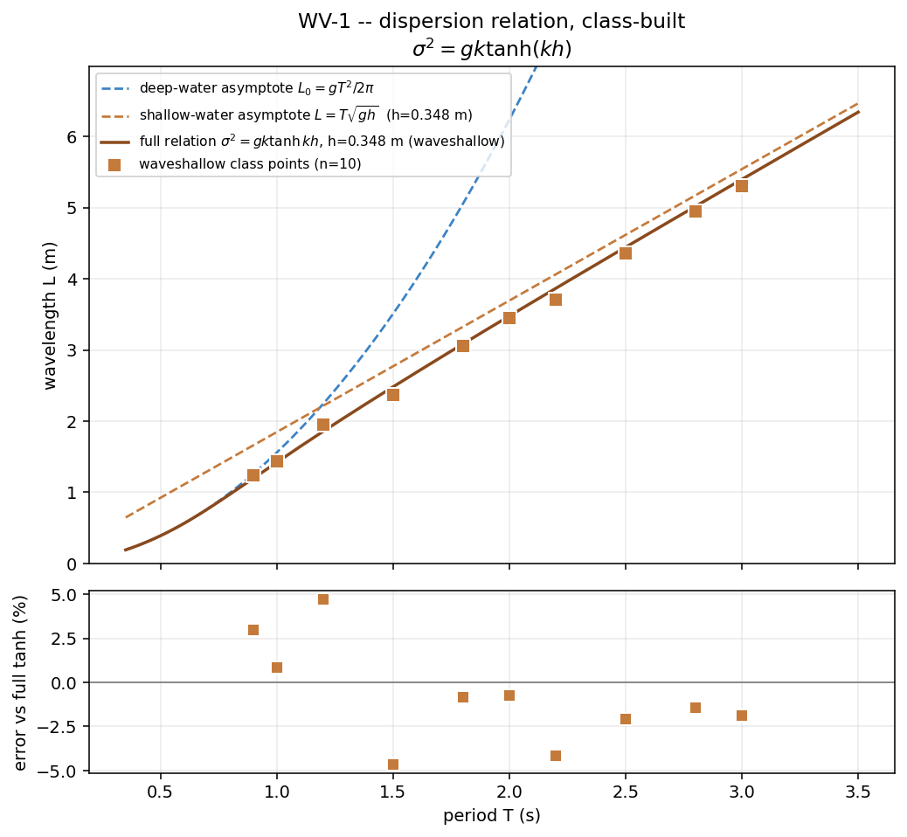

# WV-1 · Dispersion, one period each

## Lecturer notes

A quick in-class exercise, 15 minutes, that draws the dispersion relation
from a class of single measurements. Each student runs the shallow flume at
their own period, times one wave between two depth gauges two metres apart
(0.4 m for the shortest waves), and turns the time into a wavelength. Pooled
on one plot of L against T, the short periods sit near the deep-water line
L₀ = gT²/2π, the long ones approach the shallow-water line L = T√(gh), and
the ones between sag off both onto the full relation σ² = gk·tanh(kh): the
class has drawn it without anyone solving a transcendental equation by
hand.

Students submit **T, Δt and L**; the class pools them on L against T with
the full relation and both asymptotes.

**Open it:** press **E** in the [app](https://barneydobson.github.io/hydraulician/)
and pick **WV-1**, or use the direct link
[`?ex=WV-1`](https://barneydobson.github.io/hydraulician/?ex=WV-1).
How to run any exercise: see the [teaching pack index](../INDEX.md#running-an-exercise).
It runs on the `waveshallow` scene; the card sets everything up.

## The flume

`waveshallow` is a 12 m flume per metre width: a flat bed at z = 0.247 m,
still water h = 0.348 m deep, a piston paddle at x = 0.30 m and a 1 : 20
beach from x = 4.0 m. Medium gives Δx = 11.2 mm, 31 cells over the depth.
The card sets Medium, the paddle on, the gauges on Depth and particles off.
The gauges go at **x = 1.0 and 3.0 m** on the flat, or **0.6 and 1.0 m**
for the 0.9, 1.0 and 1.2 s rows, whose waves are nearly gone 2 m from the
paddle; a Depth gauge reads its column's depth whatever height it is placed
at. A pair 1.0 m apart from x = 1.0 m read the 2.0 and 2.5 s rows 6–8%
short: next to the paddle the wave field is not yet a clean progressive
wave, and two metres between the gauges averages that out.

One flume covers kh = 1.8 to 0.24: a 0.9 s wave is 5% shorter than L₀ and a
5 s wave within 1% of T√(gh). The deep-water end itself is out of reach at
Medium: a 0.7 s wave dies within a wavelength of the paddle (at a stroke of
0.015 m it is 48 mm high at x = 0.4 m and gone by 1.0 m), and a steeper
stroke only makes it break there.

The wait is about **30 s**.

## Why not the deep flume any more

The card used to run half the class in `wavedeep` (h = 0.74 m) and read
crest to crest beside the paddle. Re-measured on the current engine, that
flume does not give a clean wavelength at any period:

- **Long periods read long.** For T = 1.2–2.0 s crest to crest is 14–17%
  longer than linear dispersion (15–22% by the phase gradient). Since issue
  #72 the decaying waves drive a mean circulation, forward along the surface
  at up to 0.2 m/s, and the waves ride it; steepness adds to it (halving the
  stroke at 1.5 s halves the excess, to +8%). Before #72 the same rows read
  +2 to +10%. See the engineering notes, "The deep flume's mean circulation".
- **Short periods die at the paddle.** At the old strokes a 0.75–1.05 s wave
  stood 0.20–0.32 m high at x = 0.6 m, steeper than a wave can stand, and
  was gone within 2–6 m. At strokes small enough not to break, crest to
  crest beside the paddle read −9% to +11%, ±15% from frame to frame, and
  timing between two gauges was worse (±25–60%, except at 0.9 s).

The shallow flume has neither problem: with the gauges two metres apart
(or 0.4 m for the short waves) the timing lands within 5% of linear theory
at every period.

## The assignment

**d** is the last digit of the student number. The card prints the rule:

| d | 0 | 1 | 2 | 3 | 4 | 5 | 6 | 7 | 8 | 9 |
|---|---|---|---|---|---|---|---|---|---|---|
| **T (s)** | 0.9 | 1.0 | 1.2 | 1.5 | 2.0 | 2.5 | 3.0 | 4.0 | 5.0 | 5.0 |
| **stroke (m)** | 0.025 | 0.030 | 0.030 | 0.035 | 0.060 | 0.060 | 0.10 | 0.10 | 0.12 | 0.12 |

Small strokes on purpose: a wave high enough to be nonlinear travels faster
than linear theory says (B6 measures it), and a short one breaks at the
paddle. These keep every row's wave a few centimetres high at the gauges.

## What the students do

1. Set Period and Amplitude from the digit and press **R**; wait out the
   settle.
2. Place two Gauges (`5`) at z = 0.40 m: at x = 1.0 and 3.0 m, or at
   x = 0.6 and 1.0 m for 0.9, 1.0 and 1.2 s. Let a few waves pass, pause,
   and expand both (⤢).
3. Find one wave crossing the still depth, d = 0.348 m, on the way up on the
   nearer gauge's chart, and the same wave doing it on the farther one's. Δt
   is the time between them; the wave's speed is c = Δx/Δt (2.0 or 0.4 m)
   and its length L = cT. Every row's Δt is shorter than its period, so
   "the same wave" is the farther gauge's next up-crossing.
4. Submit T, Δt and L.

Timing a crossing of the still level rather than a crest: the crests of the
longer waves are flat-topped and hard to place in time; the up-crossing is
the steepest part of the trace.

## Theory

    σ² = gk·tanh(kh),   σ = 2π/T,   k = 2π/L,   c = L/T

Deep water (tanh kh → 1): L₀ = gT²/2π = 1.56 T². Shallow water
(tanh kh → kh): L = T√(gh), the same speed for every period. In between, the
full relation, solved here by Newton's method in `collect_plot.py`.

Worked example, T = 2.0 s: kh = 0.63, L = 3.48 m, c = 1.74 m/s, so the wave
takes Δt = 1.15 s over the two metres between the gauges. The deep-water
formula would give 6.24 m and the shallow-water one 3.70 m.

## Measured answers

Medium, after the 30 s settle: headless runs recording each column's depth
24 times a period, smoothed along the flume as a Depth gauge smooths it.
Δt is the median lag between up-crossings of the still depth over the last
12 s (15 s for the 5.0 s row), and H the median wave height at each gauge.

| T (s) | stroke (m) | gauges x (m) | kh | H (mm) | Δt (s) | L (m) | L, linear (m) | error | L₀ (m) | T√(gh) (m) |
|---|---|---|---|---|---|---|---|---|---|---|
| 0.9 | 0.025 | 0.6 and 1.0 | 1.82 | 52 / 33 | 0.301 | 1.20 | 1.20 | -0.2% | 1.26 | 1.66 |
| 1.0 | 0.030 | 0.6 and 1.0 | 1.54 | 62 / 45 | 0.277 | 1.45 | 1.42 | +1.6% | 1.56 | 1.85 |
| 1.2 | 0.030 | 0.6 and 1.0 | 1.18 | 51 / 45 | 0.251 | 1.91 | 1.86 | +2.9% | 2.25 | 2.22 |
| 1.5 | 0.035 | 1.0 and 3.0 | 0.88 | 45 / 24 | 1.216 | 2.47 | 2.48 | -0.6% | 3.51 | 2.77 |
| 2.0 | 0.060 | 1.0 and 3.0 | 0.63 | 63 / 46 | 1.177 | 3.40 | 3.48 | -2.3% | 6.25 | 3.70 |
| 2.5 | 0.060 | 1.0 and 3.0 | 0.49 | 51 / 47 | 1.131 | 4.42 | 4.45 | -0.6% | 9.76 | 4.62 |
| 3.0 | 0.100 | 1.0 and 3.0 | 0.40 | 78 / 69 | 1.161 | 5.17 | 5.40 | -4.3% | 14.05 | 5.54 |
| 4.0 | 0.100 | 1.0 and 3.0 | 0.30 | 56 / 63 | 1.107 | 7.23 | 7.28 | -0.8% | 24.98 | 7.39 |
| 5.0 | 0.120 | 1.0 and 3.0 | 0.24 | 60 / 54 | 1.089 | 9.19 | 9.15 | +0.4% | 39.03 | 9.24 |

Every row lands within 5% of linear dispersion. Neither asymptote holds
across the class: the full relation is 5% short of L₀ at 0.9 s and 17% short
at 1.2 s, and still 3% short of T√(gh) at 3.0 s.

## Pooling the class

Collect one row per student, `student,digit,T_s,dt_s,L_m` (extra columns
ignored), export the CSV and run:

```bash
python3 collect_plot.py class.csv                 # -> plots/pooled-demo.png
python3 collect_plot.py data/simulated-class.csv  # the shipped dry-run class
```

The script plots L against T with the full relation at h = 0.348 m and both
asymptotes, over a residual panel of each point's error against the full
relation. The dry-run class is the measured table, one row per digit.



## Discussion points

- **Which formula would you use for a 2 s wave here?** Neither asymptote:
  read the error each one makes off the class plot.
- **Why does a long wave not care about its period?** In shallow water every
  period travels at √(gh): ask the class to read c off the long rows.
- **Where does the wave "feel" the bottom?** kh ≈ π is the usual line for
  deep water; find the period where the class's points leave L₀.
- **What does a deeper flume change?** Nothing in the relation — only where
  on it a given period falls. (The pack's deep flume cannot show this cleanly
  at present; see above.)

## Console spot-check

Paste [rig.js](rig.js) into the console and run `await WV1.run(2.0, 0.06)`
for one row: it picks WV-1, sets the period and stroke, presses R, settles,
places the two gauges, records as the frame loop samples them and returns Δt
and L the way the card says, with linear theory beside them.
`await WV1.sweep()` runs every row the card prints.
