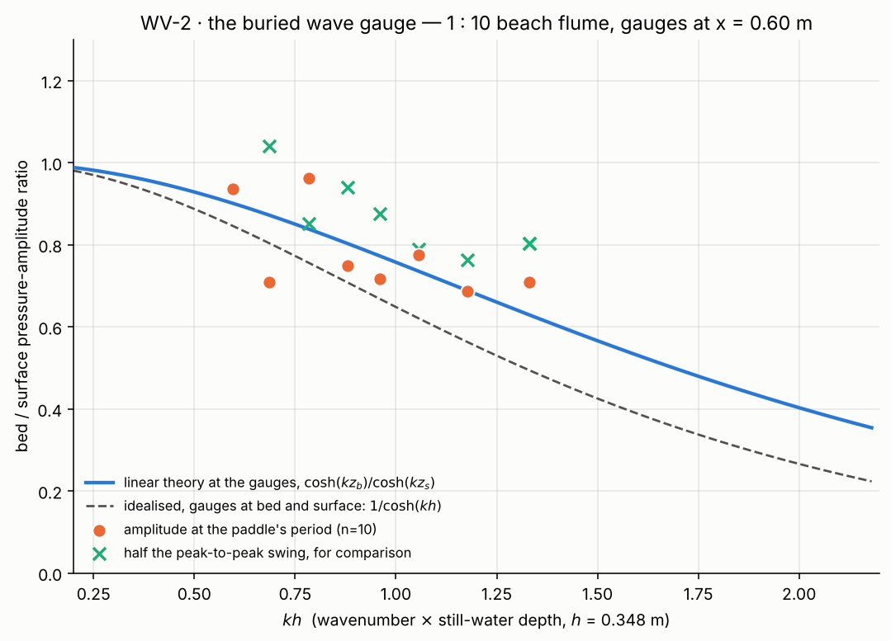

# WV-2 · The buried wave gauge

## Lecturer notes

A quick exercise, 20–25 minutes including a spreadsheet, on how wave
pressure dies with depth. Each student puts two pressure gauges on one
vertical near the paddle of the 1 : 10 beach flume — one just off the bed,
one a little below the trough — records them over a dozen periods, and works
out the ratio of the two oscillations at the paddle frequency. Linear theory
puts that ratio at `cosh(k z_bed)/cosh(k z_surface)`, which is `1/cosh(kh)`
in the limit of gauges at the bed and at the surface, so it depends on `kh`
alone. Personalising the period spreads the class along the curve, from a
bed gauge that sees 90% of the surface gauge's swing (long period) to one
that sees under two-thirds of it (short period).

Students submit **T, a_bed, a_surface and the ratio**; the class pools them
against `kh` on the theory curve.

**Open it:** press **E** in the [app](https://barneydobson.github.io/hydraulician/)
and pick **WV-2**, or use the direct link
[`?ex=WV-2`](https://barneydobson.github.io/hydraulician/?ex=WV-2).
How to run any exercise: see the [teaching pack index](../INDEX.md#running-an-exercise).
It runs on the `wave` scene; the card sets everything up.

## The flume

`wave` is a 12 m flume per metre width: a flat bed at z = 0.247 m (as the
solver rasterises it), still water h = 0.348 m deep, a piston paddle at
x = 0.30 m and a 1 : 10 beach from x = 1.2 m. Medium gives
Δx = 11.2 mm, 31 cells over the depth. The card sets Medium, the paddle on,
the gauges on h (piezometric head, z + p/ρg) and particles off. The two
gauges go on the vertical **x = 0.60 m**, on the flat between the paddle and
the beach toe, at **z = 0.27 m** (2.3 cm above the bed) and **z = 0.52 m**
(7.5 cm below the still surface, so it stays wet through the trough).

The wait is about **20 s**: the train is established at x = 0.6 m within a
few periods, and the beach is 0.6 m away.

## The assignment

**d** is the last digit of the student number. The card prints the rule:

| d | 0 | 1 | 2 | 3 | 4 | 5 | 6 | 7 | 8 | 9 |
|---|---|---|---|---|---|---|---|---|---|---|
| **T (s)** | 1.10 | 1.10 | 1.20 | 1.30 | 1.40 | 1.50 | 1.65 | 1.85 | 2.10 | 2.10 |
| **stroke (m)** | 0.055 | 0.055 | 0.055 | 0.060 | 0.060 | 0.060 | 0.060 | 0.065 | 0.070 | 0.070 |

The strokes keep the wave at x = 0.6 m below breaking steepness and the
surface gauge wet through every trough.

## What the students do

1. Set Period and Amplitude from the digit and press **R**; wait out the
   settle.
2. Place two Gauges (`5`) on x = 0.60 m, at z = 0.27 m and z = 0.52 m. The
   hover box's x, z row shows where the cursor is.
3. Let it run at least 12 s, then expand either gauge (⤢) and press
   **⤓ CSV all gauges**.
4. In a spreadsheet, keep a whole number of periods (at least eight) of the
   time column and the two `_h_m` columns. For each h column: subtract its
   mean, then take C = average of h′·cos(2πt/T) and S = average of
   h′·sin(2πt/T); the amplitude at the paddle's period is a = 2√(C² + S²).
5. Submit T, a_bed, a_surface and the ratio a_bed/a_surface.

## Theory

Linear theory gives the dynamic pressure head under a wave of amplitude a as

    p/ρg + z − z_still  =  a · cosh(k z′)/cosh(kh) · cos(kx − σt)
    σ² = gk·tanh(kh),   σ = 2π/T,   z′ = height above the bed

so two gauges on one vertical see the same wave, in phase, with amplitudes in
the ratio

    a_bed / a_surface  =  cosh(k z′_bed) / cosh(k z′_surface)

→ `1/cosh(kh)` when the gauges are at the bed and the still surface. Here
z′_bed = 0.023 m and z′_surface = 0.273 m. A seabed pressure recorder sees a
smoothed, shrunken copy of the surface above it, and how much it loses is set
by kh alone: this is the depth-correction any bottom-mounted wave gauge has
to make.

Worked example, T = 1.50 s: kh = 0.881, k = 2.53 m⁻¹, so the ratio is
cosh(0.058)/cosh(0.690) = 0.80, against the idealised 1/cosh(0.881) = 0.71.

**Why the spreadsheet and not the swing.** The traces carry more than the
paddle's wave: its harmonics, the slow seiche of the flume and short-period
chatter at the bed. All of them are in a peak-to-peak swing; only the paddle's
wave is in the amplitude at the paddle's period. The bed gauge is where the
wave is smallest and the rest is not, so the swing inflates the bed reading
most and drags the ratio towards 1. The card used to ask for the swing; the
measured table below has both.

## Measured answers

Medium, after the 20 s settle, the two gauges sampled once per 1/60 s of
simulated time for 15 s, as the frame loop samples them, and the ratio worked
from them the way the card says. Amplitudes in mm; theory is at the gauge
heights; the last column is the ratio of half the peak-to-peak swings, the
read the card used to ask for.

| T (s) | stroke (m) | kh | a_bed | a_surface | ratio | theory | error | 1/cosh(kh) | swing ratio |
|---|---|---|---|---|---|---|---|---|---|
| 1.10 | 0.055 | 1.33 | 25.9 | 36.7 | 0.708 | 0.629 | +13% | 0.495 | 0.803 (+28%) |
| 1.20 | 0.055 | 1.18 | 24.0 | 34.5 | 0.687 | 0.689 | 0% | 0.563 | 0.763 (+11%) |
| 1.30 | 0.060 | 1.06 | 29.0 | 37.0 | 0.775 | 0.735 | +5% | 0.620 | 0.788 (+7%) |
| 1.40 | 0.060 | 0.96 | 27.0 | 38.5 | 0.716 | 0.773 | −7% | 0.668 | 0.875 (+13%) |
| 1.50 | 0.060 | 0.88 | 25.6 | 34.5 | 0.749 | 0.803 | −7% | 0.707 | 0.940 (+17%) |
| 1.65 | 0.060 | 0.79 | 31.4 | 33.1 | 0.962 | 0.838 | +15% | 0.755 | 0.852 (+2%) |
| 1.85 | 0.065 | 0.69 | 25.1 | 35.4 | 0.709 | 0.872 | −19% | 0.803 | 1.040 (+19%) |
| 2.10 | 0.070 | 0.60 | 30.9 | 32.9 | 0.935 | 0.901 | +4% | 0.846 | 1.382 (+53%) |

Over the eight periods the spreadsheet ratio lands on the theory at the gauge
heights on average (+0.5%), but a single row can be up to 19% off. The
pressure field this close to the paddle carries structure of its own besides
the wave: the amplitude down one vertical is not quite monotonic (at 1.2 s,
0.70, 0.86, 0.79, 0.83 and 1.00 of the surface gauge's at z = 0.27, 0.32,
0.40, 0.47 and 0.52 m), and the two gauges sample it at two points. Expect
the class to scatter about the curve by ±10–15%; the pooled class follows it.

The swing reads 2–53% high, +19% on average. Half the peak-to-peak swing of
either trace is 1.8–4.2 times its amplitude at the paddle's period: most of
the swing is the flume's slow surging, which reaches the bed almost
undiminished, so the ratio of swings is pulled towards 1 and past it.

**Why the deep flume is no longer part of it.** The card used to send even
digits to `wavedeep` for short periods, where `1/cosh(kh)` is tiny, as a run
on which the bed gauge was "below noise". Re-measured on the current engine
at x = 1.2 m, the bed gauge there swings 15–38 mm at the paddle's own
frequency, a quarter of a period out of step with the surface gauge (70–116°),
at T = 0.6–1.2 s where linear theory allows it 0.1–30 mm. It is not the
wave and not noise: it is a pressure oscillation of the whole closed tank,
most likely the solver's own compressibility (the slot celerity, c = 26 m/s,
crosses the 12 m flume and back in 0.9 s). Averaging does not remove it, and
neither "below noise" nor the 1/cosh curve describes it.

## Pooling the class

Collect one row per student, `student,digit,T_s,a_bed_m,a_surf_m,ratio`
(extra columns ignored), export the CSV and run:

```bash
python3 collect_plot.py class.csv                 # -> plots/pooled-demo.png
python3 collect_plot.py data/simulated-class.csv  # the shipped dry-run class
```

The script solves kh from each row's period at h = 0.348 m and plots the
submitted ratio against kh on two curves: the ratio at the card's gauge
heights, which the class should land on, and the idealised 1/cosh(kh). The
dry-run class is the measured table, one row per digit.



## Discussion points

- **What does a seabed gauge see?** Less than the surface, by an amount set
  by kh. Ask the class what that does to a short, steep sea measured from the
  bed, and why bottom-mounted recorders are corrected with exactly this
  factor.
- **Why the paddle's period and not the swing?** Compare a student's ratio
  from the swing with the one from the spreadsheet. The difference is
  everything in the trace that is not the paddle's wave.
- **The gauges are not at the bed and the surface.** Score the class against
  both curves and ask which one they should land on, and why.
- **The orbits B4 traces are the same physics.** The pressure and the
  vertical motion both fall away with depth, by cosh and sinh of kz.

## Console spot-check

Paste [rig.js](rig.js) into the console and run `await WV2.run(1.50, 0.060)`
for one row: it picks WV-2, sets the period and stroke, presses R, settles,
places the two gauges, records 15 s, takes the CSV the inspector downloads
and works the ratio from it the way the card says. It returns both
amplitudes, the ratio, the theory at the gauge heights, the idealised
1/cosh(kh) and the ratio the half peak-to-peak swing would give.
`await WV2.sweep()` runs every distinct row.
