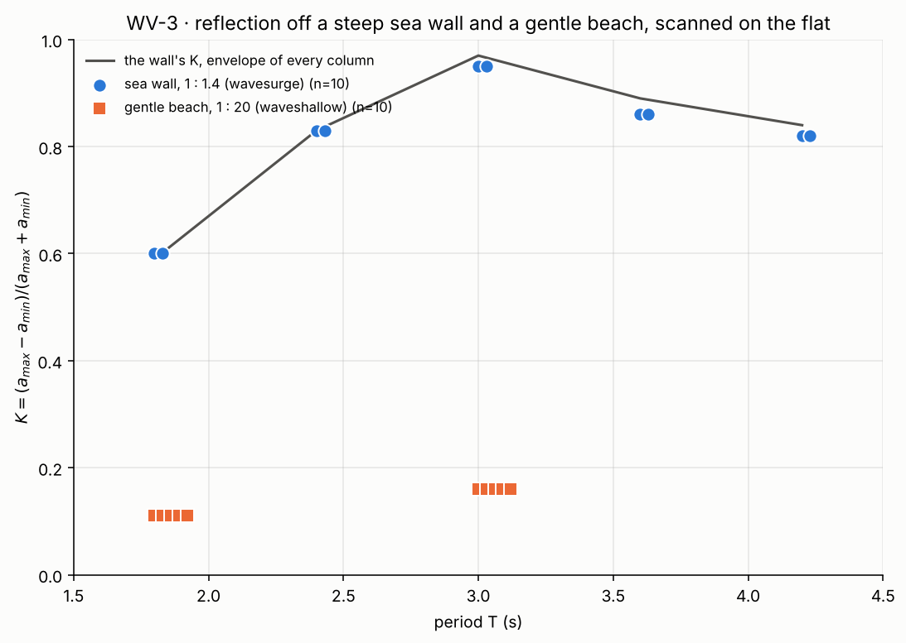

# WV-3 · Reflection coefficient of a steep sea wall

## Lecturer notes

A lab-length exercise, about an hour, on partial standing waves. Each student
drives the flume at their own period against a steep, smooth 1 : 1.4 sea
wall, scans the flat in front of it with depth gauges to find where the
wave swings most (an antinode) and least (a node), and turns the two
amplitudes into the wall's reflection coefficient,
`K = (a_max − a_min)/(a_max + a_min)`. A contrast run against a gentle
1 : 20 beach, same water and the same method, gives a small one. Pooled, the
class sees the wall reflect 0.6–0.95 of the incoming wave and the beach
too little to make a standing wave at all, and the node-to-antinode
distance checks itself against a quarter wavelength.

Students submit **T, a_max, a_min and K** for the wall, and the same for the
beach; the class pools K against T.

**Open it:** press **E** in the [app](https://barneydobson.github.io/hydraulician/)
and pick **WV-3**, or use the direct link
[`?ex=WV-3`](https://barneydobson.github.io/hydraulician/?ex=WV-3).
How to run any exercise: see the [teaching pack index](../INDEX.md#running-an-exercise).
It runs on the `wavesurge` scene, and the contrast on `waveshallow` from the
Scenes menu; the card sets both up.

## The flumes

Both are 12 m flumes per metre width with a flat bed at z = 0.247 m, still
water h = 0.348 m deep and a piston paddle at x = 0.30 m. Medium gives
Δx = 11.2 mm, 31 cells over the depth. The card sets Medium, the paddle on,
the gauges on Depth and particles off, and carries the same settings to the
contrast flume.

- `wavesurge`: the flat runs to the toe of a 1 : 1.4 slope at **x = 8.0 m**;
  the still shoreline is at x = 8.5 m.
- `waveshallow`: the flat runs to the toe of a 1 : 20 beach at
  **x = 4.0 m**; the still shoreline is at x = 11 m.

The wait is about **45 s**: the wave has to reach the wall and its
reflection come back across the flat before a pattern stands to be scanned.

**Why the scan is short, and starts at the wall.** These waves lose height
on the way to the wall — at 1.8 s from 73 mm at x = 1.3 m to 28 mm at the
toe — and the reflected wave loses height on the way back. So the ratio of
reflected to incident is largest at the wall and falls with distance from
it, and a scan along the whole flat (the old card's 1.3–7.5 m) mixes
stretches with different ratios and reads the biggest swing far from the
wall against the smallest swing near it. Half a wavelength from 0.1 m short
of the toe always holds one node and one antinode, and is as close to the
wall as a node and an antinode can be. Between them the incident wave still
loses 7–10% of its height, small beside what a whole-flat scan mixes in.

**Why a fitted amplitude, not the swing.** At the node the incident and
reflected first harmonics nearly cancel, and what is left on the chart is
mostly the wave's higher harmonics. At 3.0 s the swing at the true node is
41 mm where the first harmonic is 1 mm, and the smallest swing of the scan
sits a whole step from the node; read off the swings, K comes out at
0.31–0.71 against 0.59–0.97. So every gauge is read the way WV-2 reads its
two: the amplitude at the paddle's period, fitted from the CSV in a
spreadsheet.

**Why the last round.** The node is sharp. With most of the wave reflected,
a gauge a tenth of a metre off it reads several times the true minimum (at
3.0 s, 5 mm against 1) and K comes out 0.1 low. Four gauges a quarter and half a step
either side of the scan's smallest amplitude find it to within an eighth of
a step, which is close enough.

## The assignment

**d** is the last digit of the student number. The card prints the rule:

| d | 0 | 1 | 2 | 3 | 4 | 5 | 6 | 7 | 8 | 9 |
|---|---|---|---|---|---|---|---|---|---|---|
| **T (s)** | 1.80 | 1.80 | 2.40 | 2.40 | 3.00 | 3.00 | 3.60 | 3.60 | 4.20 | 4.20 |
| **stroke (m)** | 0.080 | 0.080 | 0.110 | 0.110 | 0.140 | 0.140 | 0.170 | 0.170 | 0.200 | 0.200 |
| **gauge step (m)** | 0.15 | 0.15 | 0.20 | 0.20 | 0.25 | 0.25 | 0.30 | 0.30 | 0.40 | 0.40 |

The step is about L/20, so the twelve stations span a little over half a
wavelength. The contrast run goes by parity: **even d** at 1.80 s, 0.080 m,
step 0.15 m; **odd d** at 3.00 s, 0.140 m, step 0.25 m.

## What the students do

1. Set Period and Amplitude from the digit and press **R**; wait out the
   settle.
2. Place four Gauges (`5`) at z = 0.42 m: x = 7.90 m and one, two and three
   steps back towards the paddle. Let three waves pass, pause, expand one
   (⤢) and press **⤓ CSV all gauges**.
3. Run on and do the same for the next four and the last four (a fifth
   gauge replaces the oldest): twelve stations, three CSVs.
4. In a spreadsheet, for each gauge keep exactly three periods of `t` and
   its `_d_m` column, subtract the mean, C = average of d′·cos(2πt/T),
   S = average of d′·sin(2πt/T): a = 2√(C² + S²). The largest a is a_max,
   at the antinode; the smallest marks the node.
5. Place four gauges a quarter and half a step either side of the node, let
   four waves pass, CSV, and take their a: a_min is the smallest a near the
   node.
6. K = (a_max − a_min)/(a_max + a_min); node to antinode should be L/4,
   with σ² = gk·tanh(kh).
7. Repeat on `waveshallow` (Scenes menu) with the contrast row, scanning
   from x = 3.90 m back. An amplitude that only falls towards the beach,
   with no rise and fall, is no standing wave: K from it is an upper bound.
   Submit T, a_max, a_min and K for both.

One formula, filled right across the columns, does every gauge of a CSV at
once; set it up on the first and the rest is pasting.

## Theory

An incident wave and its reflection add to a pattern whose amplitude
envelope is fat at the antinodes and thin at the nodes:

    a(x) = |a_i e^{−ikx} + a_r e^{ikx}|,   a_max = a_i + a_r,   a_min = a_i − a_r
    K = a_r / a_i = (a_max − a_min) / (a_max + a_min)
    node to antinode = L/4,   σ² = gk·tanh(kh)

A perfect reflector leaves a_min = 0 and K = 1; a perfect absorber leaves
no pattern and K = 0. A smooth impermeable slope reflects more the steeper
it is and the longer the wave: the Iribarren number ξ = tanβ/√(H/L₀) sets
it, and a slope with ξ above ~3 reflects most of what arrives. Rubble
mounds and real beaches reflect less; 0.05–0.2 is the usual range for a
natural beach.

Worked example, T = 2.4 s: kh = 0.51, L = 4.26 m, so the node and the
antinode are 1.06 m apart, about five of the 0.20 m steps.

## Measured answers

Medium, after the 45 s settle, the card's procedure as [rig.js](rig.js)
runs it: twelve stations three waves each, then four around the node over
four waves, every one read as the amplitude at the paddle's period. "K
from swings" is the same scan read off the charts instead. "Envelope K" is
what the procedure estimates: the first-harmonic amplitude of every column
of the flat over the last six periods, its largest and smallest within the
same half wavelength from the wall.

| flume | T (s) | stroke (m) | step (m) | antinode x (m) | node x (m) | a_max (mm) | a_min (mm) | K | K from swings | envelope K | node–antinode / (L/4) |
|---|---|---|---|---|---|---|---|---|---|---|---|
| sea wall | 1.8 | 0.080 | 0.15 | 7.15 | 7.86 | 20.3 | 5.1 | 0.60 | 0.53 | 0.59 | 0.92 |
| sea wall | 2.4 | 0.110 | 0.20 | 6.50 | 7.55 | 54.3 | 4.9 | 0.83 | 0.71 | 0.83 | 0.99 |
| sea wall | 3.0 | 0.140 | 0.25 | 5.65 | 7.09 | 68.8 | 1.8 | 0.95 | 0.42 | 0.97 | 1.06 |
| sea wall | 3.6 | 0.170 | 0.30 | 4.90 | 6.85 | 45.0 | 3.4 | 0.86 | 0.46 | 0.89 | 1.19 |
| sea wall | 4.2 | 0.200 | 0.40 | 4.30 | 6.50 | 95.2 | 9.3 | 0.82 | 0.31 | 0.84 | 1.15 |
| beach | 1.8 | 0.080 | 0.15 | 2.25 | 3.90 | 35.6 | 28.6 | 0.11 | 0.14 | 0.08 | 2.14 |
| beach | 3.0 | 0.140 | 0.25 | 1.15 | 3.96 | 47.9 | 34.4 | 0.16 | 0.16 | 0.17 | 2.08 |

What the table says:

- **The procedure finds the wall's K.** At every period K lands within 0.03
  of the envelope it is estimating. At 1.8 s, where the node is only 5 mm
  and wanders from wave to wave, which three waves a student happens to
  read moves K between 0.58 and 0.66; at the longer periods it does not
  move.
- **K is high at every period, and highest in the middle.** 0.60 at 1.8 s,
  0.95 at 3.0 s, 0.82–0.86 at 3.6 and 4.2 s; ξ₀ runs from 9 to 16 (B5
  measures it), far into the surging band at every row.
- **Swings cannot do it.** Read off the charts the same scan gives
  0.31–0.71: low at every period, because the higher harmonics fill the
  node, and 0.4–0.5 low from 3.0 s up, where those harmonics are
  strongest.
- **The old full scan could not either.** From 1.3 to 7.5 m, the old
  card's span, the swings give 0.50, 0.73 and 0.45 at 1.8, 2.4 and 3.0 s.
- **Node to antinode is a rough quarter wavelength:** 0.92–1.19 L/4. The
  node is sharp and found to an eighth of a step; the antinode is broad, and
  the largest of twelve amplitudes can sit a step from it.
- **The beach has no standing wave to measure.** On `waveshallow` the
  amplitude only falls towards the beach, 20–30% across the scan at both
  periods, as the wave loses height on the way in; what returns from a
  shoreline 7 m up a 1 : 20 slope is lost in that. The procedure's
  "antinode" and "node" are the two ends of the scan, twice a quarter
  wavelength apart, and K = 0.11 and 0.16 is the decay across it: an upper
  bound on the beach's reflection, inside the 0.05–0.2 of a natural beach.

## Pooling the class

Collect one row per student per flume,
`student,digit,series,T_s,a_max_m,a_min_m,K` with `series` either `wall`
or `beach` (extra columns ignored), export the CSV and run:

```bash
python3 collect_plot.py class.csv                 # -> plots/pooled-demo.png
python3 collect_plot.py data/simulated-class.csv  # the shipped dry-run class
```

The script plots K against T for both series over the wall's envelope K,
and prints each series' range and the wall points' distance from the
envelope. The dry-run class is the measured table.



## Discussion points

- **What would a real sea wall do?** A smooth impermeable slope this steep
  reflects most of what reaches it, and these numbers are in that range.
  Ask what a rubble mound, a stepped face or a gentler slope changes, and
  check the last against the contrast run.
- **Why does the swing lie at the node?** Put the 3.0 s CSV of a node
  gauge on a chart: a small fast wobble, twice the paddle's frequency,
  rides on almost nothing. The fit at the paddle's period ignores it; the
  eye cannot.
- **Why scan near the wall?** Both waves lose height as they travel, so the
  ratio of reflected to incident is largest at the wall and falls with
  distance from it. Ask the class to repeat the procedure a wavelength
  further out and compare.
- **The standing pattern as a ruler.** Node to antinode is L/4: pair it
  with WV-1, which measures L from timing alone.

## Console spot-check

Paste [rig.js](rig.js) into the console and run `await WV3.run(2.4, 0.11)`
for one row, or `await WV3.run(1.8, 0.08, "waveshallow")` for the contrast:
it picks WV-3, takes the flume, sets the period and stroke, presses R,
settles, scans twelve stations four at a time as the card says, places the
last four around the node and returns a_max, a_min, K and the K the
swings alone would give.
`await WV3.sweep()` runs every row the card prints.
